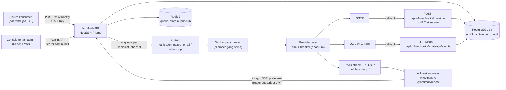

# Arsitektur: gambaran sistem

Halaman ini menjelaskan **bagaimana NotifHub bekerja sebagai satu sistem**: komponen, alur satu
notifikasi, lane autentikasi, queue, model data, dan route yang tersedia. Ini bukan dokumen desain
per fitur — rincian dan alasan keputusan ada di [design/](../design/README.md).

Repo ini adalah satu service NestJS (backend) plus beberapa paket klien: SDK JavaScript/React,
console tenant admin, dan SDK Go. Tidak ada service terpisah untuk worker.

## Komponen



| Komponen | Teknologi | Peran |
|---|---|---|
| Backend | NestJS 11, TypeScript, Prisma 6, PostgreSQL 16 | Ingest, orkestrasi, worker, Admin API, health, metrics |
| Queue | BullMQ di Redis 7 | Satu queue per channel; retry dengan exponential backoff |
| Event bus in-app | Redis Stream (replay) + Pub/Sub (live) | Push real-time ke browser, catch-up setelah reconnect |
| Provider | SMTP (Nodemailer), Meta WhatsApp Cloud API, in-app | Pengiriman aktual, dibungkus circuit breaker |
| Console | React 18, Vite, Bootstrap 5 | UI tenant admin (data lewat Admin API) |
| SDK | `@notifhub/js`, `@notifhub/react`, Go module | Klien konsumen dan end-user |
| Storage aset | Filesystem `TEMPLATE_IMAGE_DIR` | Gambar template, URL publik UUID |

## Alur satu notifikasi

```mermaid
sequenceDiagram
  participant C as Consumer
  participant A as API
  participant D as PostgreSQL
  participant Q as BullMQ (Redis)
  participant W as Worker
  participant P as Provider
  C->>A: POST /api/v1/notify (X-API-Key, idempotency_key)
  A->>D: Notification + NotificationRecipient (status pending)
  A-->>C: 202 { notification_id, status: accepted }
  A->>Q: enqueue satu job per (recipient, channel)
  Q->>W: job
  W->>D: resolve template aktif + preferensi recipient
  W->>P: kirim (in-app / email / WhatsApp)
  P-->>W: hasil kirim
  W->>D: status sent/failed/skipped + DeliveryAttempt
  P-->>A: webhook status (delivered, read, ...)
  A->>D: DeliveryEvent + update monotonik; rollup overallStatus tiap menit
```

Yang perlu diingat dari alur ini:

1. **Ingest hanya menerima dan meng-enqueue.** `202` berarti diterima, bukan terkirim. Status akhir
   ada di `NotificationRecipient`.
2. **Fan-out per recipient, per channel.** Satu notifikasi bisa `partial` bila sebagian recipient
   berhasil.
3. **Idempotensi di ingest, per tenant.** `idempotency_key` yang sama dalam `IDEMPOTENCY_TTL_DAYS`
   (default 7 hari) mengembalikan notification id yang sama; key yang sama di tenant lain membuat
   notifikasi terpisah.
4. **Preferensi dicek di worker, bukan di ingest.** Kanal nonaktif ditandai `skipped`
   (`preference_disabled`); quiet hours menunda job non-kritis.
5. **Template di-resolve saat eksekusi job.** Template yang hilang/tidak aktif menghasilkan
   `UnrecoverableError` (`template not found: <key>`) sehingga job tidak di-retry dan recipient
   berakhir `failed`.
6. **Status webhook bersifat monotonik.** Event yang lebih lama tidak boleh menurunkan status, lalu
   `overallStatus` digulung tiap menit.

Nilai status yang dipakai:

| Tempat | Nilai |
|---|---|
| `NotificationRecipient.status` | `pending`, `sent`, `failed`, `read`, `skipped` |
| `Notification.overallStatus` | `pending`, `partial`, `sent`, `failed` |
| Template | `draft`, `published`; format `text`, `html`, `markdown` |

## Lane autentikasi

Kredensial **tidak bisa ditukar** antar lane, dan tenant selalu diturunkan dari kredensial — bukan
dari body request.

| Lane | Kredensial | Dipakai untuk | Tenant dari |
|---|---|---|---|
| Consumer (ingest) | `X-API-Key: nhk_...` (tabel `ApiKey`, hash SHA-256) | `/notify`, subscribers, topics | API key |
| Admin (tenant) | `Authorization: Bearer <admin JWT>` (`ADMIN_JWT_SECRET`, role `tenant_admin`) | `/admin/*` | klaim token |
| Subscriber (end-user) | `Authorization: Bearer <subscriber JWT>` (secret per tenant) | in-app, SSE, preference center | klaim token |
| Platform | `Authorization: Bearer <platform admin JWT>` (role `platform_admin`, **tanpa** klaim tenant) | `/platform/auth/*`, provisioning tenant, tenant admins, audit | — |

Konsekuensi yang sering menjadi sumber bug:

- `tenant_id` di body ingest bersifat deprecated; bila dikirim harus sama dengan tenant API key
  (`400` bila berbeda).
- Token subscriber ditandatangani dengan secret API key tenant; `SUBSCRIBER_JWT_SECRET` hanya
  fallback bila tenant belum punya secret sendiri.
- `platform_admin` memakai lane platform (`/platform/*`), bukan Admin API; provisioning tenant,
  suspend, dan audit sudah berjalan. RBAC granular belum ada.
- Token di query string ditolak; hanya header `Authorization` yang diterima.

Detail keputusan: [admin-api §2](../design/admin-api.md#2-tiga-jalur-autentikasi-tidak-boleh-tercampur)
dan [preference-center §6](../design/preference-center.md#6-verifikasi-jwt-subscriber-per-tenant).

## Channel dan worker

| Channel | Queue | Provider | Perilaku development |
|---|---|---|---|
| in-app | `notification-inapp` | Redis stream + pub/sub | Selalu "terkirim" ke stream; UI bisa diverifikasi lewat curl |
| email | `notification-email` | SMTP | Log-only, `providerMessageId=dev-log-only`, tidak ada koneksi SMTP |
| WhatsApp | `notification-whatsapp` | Meta Cloud API | Log-only; stub lokal `scripts/dev-whatsapp-stub.mjs` |
| sms | — | — | Belum ada provider/worker. Ingest tetap menerima `sms`, tetapi recipient ditandai `skipped`; `PUT /subscriber/preferences/sms` ditolak `400` |

Queue terdaftar dengan prefix Redis `notifhub`; nama queue memakai tanda hubung karena BullMQ
menolak `:` (pemisah key Redis). Worker berjalan di proses backend yang sama, jadi `npm run
start:dev` sudah menjalankan ketiga worker. Setiap job memakai kebijakan retry yang sama: 5
percobaan dengan exponential backoff mulai 2 detik. Bila Redis tidak tersedia, ingest menjawab
`503` selama `FAIL_MODE_ON_REDIS_DOWN=closed` (default); mode `open` membiarkan perintah di-buffer
agar restart Redis singkat tidak menggagalkan request.

Mode runtime (`NOTIFHUB_MODE`) mengubah perilaku pengiriman:

| Mode | Email/WhatsApp | Catatan |
|---|---|---|
| `development` | log-only | Semua verifikasi lokal, tidak menyentuh provider nyata |
| `staging` | dikirim ke `CATCH_ALL_RECIPIENT` | Mencegah kirim ke penerima asli saat uji |
| `production` | dikirim ke penerima asli | Wajib `SMTP_*`, `SWAGGER_BASIC_AUTH_*`, secret ≥ 32 karakter |

## Model data

Tabel utama bersifat tenant-scoped (`tenantId`); tabel anak (`NotificationRecipient`,
`DeliveryAttempt`, `DeliveryEvent`, `TopicSubscriber`, `TemplatePartialLink`) mewarisi tenant dari
induknya. Ringkasan model di `prisma/schema.prisma`:

| Kelompok | Model | Kegunaan |
|---|---|---|
| Notifikasi | `Notification`, `NotificationRecipient`, `DeliveryAttempt`, `DeliveryEvent`, `BillingEvent` | Permintaan, status per recipient/channel, percobaan kirim, event webhook, event billing per notifikasi |
| Template | `NotificationTemplate`, `TemplateLayout`, `TemplateTheme`, `TemplatePartial`, `TemplatePartialLink`, `TemplateAuditEvent`, `TemplateTestSend`, `TemplateImage` | Template berversi + aset authoring, audit, test send, gambar |
| Preferensi | `NotificationPreference` | Per `tenantId + recipientId + channel`, termasuk quiet hours |
| Penerima & topik | `Subscriber`, `Topic`, `TopicSubscriber` | Snapshot data dari consumer, membership topik (bisa time-bound) |
| Auth | `ApiKey`, `AdminUser` | API key per tenant (hash), admin tenant |
| Tenant | `Tenant` | Nama + status tenant; semua tabel ber-`tenantId` punya FK ke sini |
| Audit platform | `PlatformAuditEvent` | Jejak append-only mutasi platform (actor, aksi, tenant, metadata non-rahasia) |

Relasi penting: `NotificationRecipient` menyimpan `templateId`/`templateVersion`/
`templateResolvedAt` yang diisi worker saat resolve, sehingga kiriman bisa ditelusuri ke versi
template yang dipakai.

## Kontrak HTTP

Prefix global `api/v1`; path berikut dikecualikan dari prefix:
`/health/live`, `/health/ready`, `/metrics`, `/api/docs`, `/api/docs-json`.

| Grup | Path | Lane |
|---|---|---|
| Ingest | `POST /api/v1/notify` | API key |
| Subscriber (push-sync) | `PUT`, `GET /api/v1/subscribers/:externalId` | API key |
| Topik | `PUT`, `POST`, `GET /api/v1/topics/:key/members` | API key |
| In-app | `GET /api/v1/in-app/notifications`, `POST .../notifications/:id/read`, `GET /api/v1/in-app/stream` | Subscriber JWT |
| Preferensi end-user | `GET /api/v1/subscriber/preferences`, `PUT /api/v1/subscriber/preferences/:channel` | Subscriber JWT |
| Admin auth | `POST /api/v1/admin/auth/login`, `GET /api/v1/admin/auth/me` | publik / admin JWT |
| Admin data | `/api/v1/admin/{api-keys,templates,template-assets,subscribers,topics,notifications}` | Admin JWT |
| Platform auth | `POST /api/v1/platform/auth/login`, `GET /api/v1/platform/auth/me` | publik / platform JWT |
| Platform tenant | `GET/POST /api/v1/platform/tenants`, `GET/PATCH/DELETE .../tenants/:id`, `POST .../suspend`, `POST .../resume` | platform JWT |
| Platform admin tenant | `GET/POST /api/v1/platform/tenants/:id/admins`, `PATCH .../admins/:adminId` | platform JWT |
| Platform audit | `GET /api/v1/platform/audit` | platform JWT |
| Webhook provider | `POST /api/v1/webhooks/:provider` | HMAC `WEBHOOK_SIGNING_SECRET` |
| Webhook WhatsApp | `GET`, `POST /api/v1/webhooks/whatsapp/events` | `X-Hub-Signature-256` |
| Health | `GET /health/live`, `GET /health/ready` | publik |
| Metrics | `GET /metrics` | header `X-API-Key` |
| Dokumentasi | `GET /api/docs`, `GET /api/docs-json` | basic auth di luar development |

Bentuk error seragam (`statusCode`, `message`, `error`, `timestamp`, `path`, `requestId`).
`requestId` juga muncul di log server — sertakan saat melaporkan masalah.

## Redis dan background job

| Key / mekanisme | Kegunaan |
|---|---|
| `notifhub:inapp:events:<tenant>:<recipient>` (pub/sub) | Fan-out live ke koneksi SSE |
| `notifhub:inapp:stream:<tenant>:<recipient>` (stream) | Buffer replay (default 300 detik, `SSE_REPLAY_BUFFER_SECONDS`) |
| BullMQ (`notifhub` prefix) | Tiga queue channel |

| Job terjadwal | Jadwal (UTC) | Efek |
|---|---|---|
| Rollup status | tiap menit | Hitung `overallStatus` dari status recipient |
| Retention | 02:00 | Soft delete notifikasi lebih tua dari `RETENTION_DAYS` |
| Idempotency cleanup | 02:30 | Rotasi key kedaluwarsa ke `expired:<uuid>` |
| Template telemetry | 03:00 | Hapus `TemplateTestSend`/`TemplateAuditEvent` melewati retensi |

## Frontend dan SDK

| Paket | Isi | Dipakai oleh |
|---|---|---|
| `packages/js-sdk/` (`@notifhub/js`) | Klien in-app, transport SSE, `NotifHubAdminClient`, method preferensi | Aplikasi end-user dan console |
| `packages/react/` (`@notifhub/react`) | Provider, hook, bell, inbox, `usePreferences` | Aplikasi React end-user |
| `console/` (`notifhub-console`) | Console tenant admin + halaman platform (`/platform/*`); dua artifact (`dist/tenant`, `dist/platform`) untuk origin terpisah | Operator tenant dan platform admin |
| `sdk/go/` (`github.com/hamdanidev/notifhub-go`) | Klien Go untuk endpoint consumer | Service konsumen |
| `sample/in-app-web/` | Sample React 18 untuk in-app + preferensi (dev-only) | Referensi integrasi |

Kontrak SDK diturunkan dari OpenAPI: `GET /api/docs-json` → `openapi/notifhub.json` (subset
consumer) → generator Go. Jangan mengedit `sdk/go/client.gen.go` secara manual.

## Prinsip arsitektur yang disengaja

- **SDK-first.** `POST /api/v1/notify` adalah entry point utama; OpenAPI adalah sumber kontrak.
- **Satu lane, satu kredensial.** Tidak ada endpoint yang menerima kredensial lane lain.
- **Tenant dari kredensial.** Body tidak boleh menentukan tenant.
- **Push, bukan pull.** Data subscriber hanya dikirim consumer; NotifHub tidak pernah menarik data
  dari sistem consumer.
- **Provider abstraction.** Setiap kanal lewat interface yang sama, dibungkus circuit breaker,
  sementara retry tetap dimiliki BullMQ.
- **Status monotonik.** Callback provider tidak boleh memundurkan status pengiriman.
- **Mode eksplisit.** `development`/`staging` tidak pernah mengirim ke penerima asli.
- **Suspend = ingress.** Tenant `suspended` ditolak `403 tenant_suspended` di ingest, admin tenant,
  dan subscriber; webhook tetap dicatat dan job yang sudah antre tetap diproses. `/metrics` dibuat
  sebagai pengecualian agar monitoring tidak ikut mati.

Batasan yang masih terbuka (WhatsApp text-only, RBAC belum ada, dan seterusnya) dirangkum di
[project-brief §6](../architecture/project-brief.md#6-batasan-dan-deviasi-yang-diketahui).

## Bacaan lanjutan

- Menjalankan lokal: [local setup](../getting-started/local-setup.md)
- Konfigurasi: [configuration](../getting-started/configuration.md)
- Desain per fitur: [design/README.md](../design/README.md)
- Panduan pemakaian API: [usage/README.md](../usage/README.md)
- Test, image Docker, dan CI: [production readiness](../operations/production-readiness.md)
- Multi-tenant (terimplementasi): [desain platform admin](../design/multi-tenant-platform-admin.md) · [panduan platform admin](../usage/platform-admin.md)
