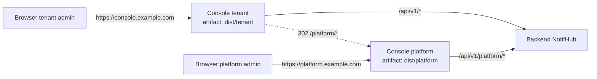

# Desain pemisahan console platform ke host terpisah

Status: **P1–P3 terimplementasi dan terverifikasi** (split build dua artifact, image/stage Docker
ganda, nginx template + guard, compose dua console, CI dua artifact/image) pada 2026-11-20; P4
(rollout host platform) belum. Draf disetujui 2026-11-19. Lihat §18 untuk catatan implementasi.
Tanggal: 2026-11-19. Bahasa: Indonesia.

Basis: `console/` (React 18 + Vite), `console/Dockerfile`, `console/nginx/*.template`,
`docker-compose.prod.yml`, `.github/workflows/ci.yml`, `docs/design/multi-tenant-platform-admin.md`
§11–§12, dan `README.md` bagian Docker.

**Isi dokumen**

- [1. Latar belakang](#1-latar-belakang)
- [2. Kondisi saat ini](#2-kondisi-saat-ini)
- [3. Tujuan dan non-tujuan](#3-tujuan-dan-non-tujuan)
- [4. Opsi desain](#4-opsi-desain)
- [5. Keputusan](#5-keputusan)
- [6. Arsitektur target](#6-arsitektur-target)
- [7. Perubahan build dan kode](#7-perubahan-build-dan-kode)
- [8. Deployment dan Docker](#8-deployment-dan-docker)
- [9. Konfigurasi dan CORS](#9-konfigurasi-dan-cors)
- [10. Migrasi dan rollout](#10-migrasi-dan-rollout)
- [11. Keamanan](#11-keamanan)
- [12. Fase implementasi](#12-fase-implementasi)
- [13. Verifikasi](#13-verifikasi)
- [14. Daftar file](#14-daftar-file)
- [15. Risiko](#15-risiko)
- [16. Definition of done](#16-definition-of-done)
- [17. Pertanyaan keputusan](#17-pertanyaan-keputusan)
- [18. Catatan implementasi](#18-catatan-implementasi)

---

## 1. Latar belakang

Console tenant dan console platform saat ini adalah **satu SPA** di satu origin (`console/`):
router yang sama memuat rute tenant (`/`, `/notifications`, …) dan rute platform
(`/platform/*`). Pemisahan lane secara logika sudah ada (session terpisah, route guard, transport
terpisah), tetapi secara origin keduanya berbagi:

- satu bundel JavaScript yang memuat kode tenant **dan** platform,
- satu origin, sehingga `sessionStorage` tenant dan platform berada di namespace origin yang sama
  (kunci berbeda, tetapi XSS di salah satu halaman dapat membaca keduanya),
- satu deployment / satu jadwal rilis,
- satu kebijakan akses jaringan.

Dokumen ini merancang pemisahan console platform ke host/origin sendiri, tanpa memecah codebase
React dan tanpa mengubah API backend.

## 2. Kondisi saat ini

| Aspek | Kondisi |
|---|---|
| Entry | `console/index.html` → `console/src/main.tsx` → `AuthProvider` + `router` |
| Router | `console/src/App.tsx` memuat route tenant dan `/platform/*` |
| Build | `console/package.json`: `build = tsc --noEmit && vite build` → satu `console/dist` |
| Image | `console/Dockerfile`: build stage Vite + runner nginx (`console/nginx.conf`) |
| Compose | satu service `console` (`8080:80`) di `docker-compose.prod.yml` |
| API base | `VITE_NOTIFHUB_API_URL` build arg (`CONSOLE_API_URL` di compose) |
| CORS | `CORS_ORIGINS` di backend; harus memuat origin console |
| Session | `sessionStorage`: `notifhub.console.session` (tenant) dan `notifhub.console.platform-session` |
| CI | job `packages` menjalankan `console:typecheck` dan `console:build`; job `docker` membangun image console |
| Route platform | `/platform/login`, `/platform/tenants`, `/platform/tenants/:id`, `/platform/audit` |

Konsekuensi yang relevan:

1. Pengguna tenant mengunduh bundel yang memuat kode dan label platform — walau tidak menautkannya,
   rute dan string tetap ada di bundle.
2. Belum ada batas origin: XSS di console tenant berpotensi membaca session platform bila operator
   membuka keduanya di tab yang sama (sessionStorage memang per-tab, tetapi satu origin).
3. Tidak ada cara membatasi akses console platform lewat ingress (VPN/IP allowlist) tanpa ikut
   membatasi console tenant.
4. Rilis console tenant dan platform selalu bersamaan.

## 3. Tujuan dan non-tujuan

### Tujuan

1. Console platform disajikan dari **origin terpisah** (host/subdomain atau port terpisah pada
   smoke stack), dengan artifact build sendiri.
2. Bundel tenant **tidak** memuat kode/rute platform; bundel platform tidak memuat halaman tenant.
3. Session platform berada di origin sendiri (isolasi `sessionStorage`/cookie mengikuti origin).
4. Console platform dapat dibatasi aksesnya di ingress (IP allowlist/VPN/basic auth) dan dirilis
   terpisah dari console tenant.
5. Satu codebase dan satu design system tetap dipertahankan; tidak ada duplikasi komponen.
6. Perubahan API backend: **tidak ada** (selain CORS origin baru).

### Non-tujuan

- SSO/OIDC untuk platform admin (tetap JWT dari `/platform/auth/login`).
- Pemisahan repo/paket npm `console-platform` (opsi jangka panjang, §4 opsi C).
- RBAC granular atau perubahan lane auth.
- TLS/secret manager produksi (tetap di luar smoke stack; ingress nyata di luar repo).
- Mengubah path API (`/api/v1/platform/*` tetap).
- Menghapus route `/platform/*` di backend (backend tidak punya route UI; ini hanya console).

## 4. Opsi desain

| Opsi | Isi | Kelebihan | Kekurangan |
|---|---|---|---|
| **A (dipilih)** | Satu codebase, dua entry build (`index.html` tenant, `platform.html` platform), dua artifact, dua image/stage Docker, dua host | Isolasi artifact + origin; satu design system; tidak ada duplikasi paket | Dua build/CI step; dua image; konfigurasi nginx/CORS bertambah |
| B | Satu image, dua container memakai image sama dengan env pemilih entry/nginx | Paling sedikit perubahan image | Artifact tenant tetap mengandung aset platform; isolasi artifact lemah; env runtime pemilih entry menambah kompleksitas |
| C | Paket terpisah `console-platform/` (workspace) memakai komponen bersama | Isolasi kode paling tegas; rilis independen penuh | Duplikasi/extrasi komponen ke paket shared; biaya refactor besar; dua package.json/CI |
| D | Status quo (satu SPA, satu host) | Nol biaya | Tidak memenuhi tujuan isolasi origin/artifact |

Opsi A dipilih: manfaat isolasi didapat tanpa memecah codebase, dan jalur ke opsi C tetap terbuka
bila UI platform tumbuh besar.

## 5. Keputusan

| # | Keputusan | Usulan default |
|---|---|---|
| D1 | Dua entry build dari satu paket: `index.html`+`src/main.tsx` (tenant) dan `platform.html`+`src/platform-main.tsx` (platform) | Ya |
| D2 | Dua output build terpisah: `console/dist/tenant` dan `console/dist/platform` | Ya |
| D3 | Dua stage Docker (`runner-tenant`, `runner-platform`) dari satu Dockerfile; default target tetap `runner-tenant` agar perintah lama tidak berubah | Ya |
| D4 | Dua host: tenant (mis. `console.example.com`) dan platform (mis. `platform.example.com`); smoke stack memakai `:8080` dan `:8081` | Ya |
| D5 | URL platform di host platform tetap memakai prefix `/platform/*` pada v1 agar bookmark, dokumentasi, dan test tidak berubah; root `/` diarahkan ke `/platform/tenants` | Ya |
| D6 | Host tenant tidak lagi memuat route platform; `/platform/*` di host tenant diarahkan (302) ke host platform memakai env `PLATFORM_CONSOLE_URL` | Ya |
| D7 | Isolasi session mengikuti origin: kunci `notifhub.console.platform-session` tetap, tetapi kini berada di origin platform | Ya |
| D8 | `CORS_ORIGINS` backend memuat origin tenant **dan** platform | Ya |
| D9 | Tidak ada perubahan kontrak API/backend selain CORS | Ya |
| D10 | Akses platform dapat dibatasi di ingress (IP/VPN/basic auth) tanpa mengubah image; tidak diimplementasikan di repo | Ya |
| D11 | Paket `console-platform` terpisah ditunda (opsi C) sampai ada kebutuhan rilis/UI yang benar-benar berbeda | Ya |

## 6. Arsitektur target



- Dua artifact statis, dua nginx, origin berbeda.
- Keduanya memanggil backend yang sama (`VITE_NOTIFHUB_API_URL` per build).
- Tidak ada proxy tambahan; CORS backend mengizinkan kedua origin.

## 7. Perubahan build dan kode

### 7.1 Entry dan router

| File | Perubahan |
|---|---|
| `console/index.html` | Tetap; hanya memuat `src/main.tsx` (tenant) |
| `console/platform.html` (baru) | Memuat `src/platform-main.tsx`; title "NotifHub Platform" |
| `console/src/main.tsx` | Tetap: `AuthProvider` + router tenant |
| `console/src/platform-main.tsx` (baru) | `QueryClientProvider` + router platform (tanpa `AuthProvider` tenant) |
| `console/src/App.tsx` | Hanya route tenant; route `/platform/*` menjadi komponen redirect eksternal |
| `console/src/PlatformApp.tsx` (baru) | Router platform: `/platform/login`, `/platform` layout + children, fallback `/platform/tenants` |
| `console/src/env.ts` | Tambah `PLATFORM_CONSOLE_URL` dari `VITE_PLATFORM_CONSOLE_URL` (opsional) untuk redirect tenant |
| `console/src/auth/ProtectedRoute.tsx` | Cek session platform dihapus (setelah split, session platform ada di origin lain sehingga tidak terlihat dari tenant build) |
| `console/src/auth/PlatformLoginPage.tsx` | Tetap, sekarang hanya diimpor entry platform |

Redirect dari host tenant:

```tsx
// console/src/components/ExternalRedirect.tsx (baru, kecil)
import { useEffect } from 'react';

export function ExternalRedirect({ to }: { to: string }): JSX.Element {
  useEffect(() => {
    window.location.replace(to);
  }, [to]);

  return <div className="empty-state">Mengalihkan ke console platform...</div>;
}
```

`/platform/*` di router tenant memakai `PLATFORM_CONSOLE_URL + pathname`; bila env kosong,
redirect dinonaktifkan dan route menjadi `NotFoundPage` (deployment lama tetap aman).

### 7.2 Vite

`console/vite.config.ts` memakai `mode` Vite sebagai pemilih target (tanpa dependency baru):

```ts
import react from '@vitejs/plugin-react';
import { defineConfig } from 'vite';

export default defineConfig(({ mode }) => {
  const target = mode === 'platform' ? 'platform' : 'tenant';

  return {
    plugins: [react()],
    server: { port: target === 'platform' ? 5174 : 5173, strictPort: true },
    preview: { port: target === 'platform' ? 4174 : 4173, strictPort: true },
    build: {
      outDir: `dist/${target}`,
      emptyOutDir: true,
      rollupOptions: { input: target === 'platform' ? 'platform.html' : 'index.html' },
    },
  };
});
```

`console/package.json`:

```json
"build": "npm run typecheck && node scripts/prepare-build.mjs && npm run build:tenant && npm run build:platform",
"build:tenant": "vite build",
"build:platform": "vite build --mode platform && node scripts/finalize-platform-build.mjs",
"preview:tenant": "vite preview --outDir dist/tenant",
"preview:platform": "vite preview --mode platform --outDir dist/platform"
```

`prepare-build.mjs` menghapus `console/dist` (termasuk layout lama di root) sebelum kedua build,
dan `finalize-platform-build.mjs` mengganti nama `dist/platform/platform.html` menjadi
`dist/platform/index.html` agar host statis menyajikan dokumen root dengan benar.

`vite build` tanpa `--mode` tetap memakai mode `production` (target tenant), sehingga perintah
`npm run console:build` lama tetap menghasilkan artifact tenant **dan** platform. Untuk dev lokal,
`npm run dev -- --mode platform` berjalan di port `5174` (tenant tetap `5173`), sehingga keduanya
bisa dijalankan berbarengan.

### 7.3 Pemisahan impor

- `main.tsx` hanya mengimpor `App.tsx` (tenant), `AuthContext`, halaman tenant.
- `platform-main.tsx` hanya mengimpor `PlatformApp.tsx`, `platformSession`, `platformClient`,
  `PlatformLayout`, halaman `pages/platform/*`.
- Komponen bersama (`PageHeader`, `DataTable`, `QueryState`, `Pagination`, `ConfirmDialog`,
  `Icon`, `format`, `queryClient`, `styles.css`) tetap dipakai kedua entry.
- Verifikasi bundel: `grep -r "NotifHub Platform" console/dist/tenant/assets` harus kosong dan
  sebaliknya untuk halaman tenant di `dist/platform/assets`.

## 8. Deployment dan Docker

### 8.1 Dockerfile multi-stage

```dockerfile
# build stage: install root + SDK + console deps + source (sama seperti sekarang,
# tetapi TIDAK menjalankan console:build di stage ini)
FROM node:24-bookworm-slim AS build
...
FROM build AS build-tenant
RUN npm --prefix console run build:tenant

FROM build AS build-platform
RUN npm --prefix console run build:platform

FROM nginx:1.27-alpine AS runner-tenant
COPY console/nginx/tenant.conf.template /etc/nginx/templates/default.conf.template
COPY console/nginx/check-platform-url.sh /docker-entrypoint.d/40-check-platform-url.sh
COPY --from=build-tenant /app/console/dist/tenant /usr/share/nginx/html
EXPOSE 80

FROM nginx:1.27-alpine AS runner-platform
COPY console/nginx/platform.conf.template /etc/nginx/templates/default.conf.template
COPY --from=build-platform /app/console/dist/platform /usr/share/nginx/html
EXPOSE 80
```

- Default `--target runner-tenant` menjaga `docker build -f console/Dockerfile .` yang sudah ada.
  Implementasi menaruh stage `runner-tenant` **terakhir** (atau compose/CI selalu menyebut target
  eksplisit) agar build tanpa `--target` tidak berubah menjadi image platform.
- Kedua stage memakai `VITE_NOTIFHUB_API_URL` yang sama (build arg), jadi API base konsisten.
- `check-platform-url.sh` menghentikan container tenant bila `PLATFORM_CONSOLE_URL` kosong
  (mencegah redirect relatif yang berputar di host yang sama).

### 8.2 nginx

| File | Isi kunci |
|---|---|
| `console/nginx/tenant.conf.template` | SPA fallback ke `index.html`; `location /platform { return 302 ${PLATFORM_CONSOLE_URL}$request_uri; }`; header keamanan sama |
| `console/nginx/platform.conf.template` | SPA fallback ke `index.html`; `location = / { return 302 /platform/tenants; }`; header keamanan sama |
| `console/nginx/check-platform-url.sh` (baru) | Entrypoint tenant: gagal cepat bila `PLATFORM_CONSOLE_URL` kosong |

Template diproses otomatis oleh image nginx (`/etc/nginx/templates/*.template` → `conf.d`), sehingga
`PLATFORM_CONSOLE_URL` dapat diisi saat container start tanpa rebuild.

### 8.3 Compose

```yaml
console:
  build:
    context: .
    dockerfile: console/Dockerfile
    target: runner-tenant
    args:
      VITE_NOTIFHUB_API_URL: ${CONSOLE_API_URL:-http://localhost:3000}
  environment:
    PLATFORM_CONSOLE_URL: ${PLATFORM_CONSOLE_URL:-http://localhost:8081}
  ports: ["8080:80"]

platform-console:
  build:
    context: .
    dockerfile: console/Dockerfile
    target: runner-platform
    args:
      VITE_NOTIFHUB_API_URL: ${CONSOLE_API_URL:-http://localhost:3000}
  ports: ["8081:80"]
```

`CORS_ORIGINS` di `.env.prod` harus memuat `http://localhost:8080,http://localhost:8081` (atau
origin produksi masing-masing).

### 8.4 CI

- Job `packages`: `npm run console:typecheck` lalu `npm run console:build` (kedua target) +
  memeriksa `console/dist/tenant/index.html` dan `console/dist/platform/index.html` ada.
- Job `docker`: build kedua target image (`runner-tenant`, `runner-platform`).

## 9. Konfigurasi dan CORS

| Variabel | Dipakai | Keterangan |
|---|---|---|
| `VITE_NOTIFHUB_API_URL` | build keduanya | Base URL backend; sama untuk tenant/platform |
| `VITE_PLATFORM_CONSOLE_URL` | build tenant | Origin platform untuk redirect `/platform/*`; opsional (kosong = tanpa redirect) |
| `PLATFORM_CONSOLE_URL` | runtime nginx tenant | URL publik platform; harus sama dengan `VITE_PLATFORM_CONSOLE_URL` |
| `CONSOLE_API_URL` | compose build arg | Tetap seperti sekarang |
| `CORS_ORIGINS` | backend | Tambahkan origin platform |

Catatan: dua variabel untuk URL platform (build-time dan runtime nginx) disengaja — build-time
dipakai untuk redirect di sisi klien, runtime untuk redirect di ingress. Dokumentasikan agar
diisi konsisten.

## 10. Migrasi dan rollout

1. **Rilis 1 (split build, satu host tetap):** kedua artifact dibangun di CI; image tenant masih
   menyajikan `dist/tenant` dan belum ada route platform di host tenant. Host platform belum
   dipublikasikan; akses platform sementara lewat `:8081` di smoke stack.
2. **Rilis 2 (host platform aktif):** deploy `platform.<domain>`; isi `PLATFORM_CONSOLE_URL` di
   host tenant. `/platform/*` di host tenant mulai 302 ke host platform. Bookmark lama tetap
   bekerja.
3. **Rilis 3 (bersih-bersih):** setelah satu siklus, evaluasi apakah redirect 302 dipertahankan
   (disarankan tetap, murah) atau diganti 404. Tidak ada perubahan API.

Tidak ada migrasi data. Session platform lama di origin tenant otomatis tidak terpakai; operator
login ulang di origin baru.

## 11. Keamanan

- **Isolasi origin**: XSS di console tenant tidak dapat membaca `sessionStorage` platform karena
  beda origin. Ini manfaat utama dibanding status quo.
- **Bundel**: kode dan route platform tidak dikirim ke browser pengguna tenant.
- **Ingress**: host platform dapat ditaruh di belakang VPN/IP allowlist/basic auth tambahan tanpa
  mengganggu tenant.
- **CORS**: backend hanya mengizinkan origin yang terdaftar; jangan memakai `*` untuk produksi.
- **Header**: nginx tetap mengirim `X-Content-Type-Options`, `X-Frame-Options: DENY`,
  `Referrer-Policy: no-referrer`.
- **Session**: token platform tetap di `sessionStorage` origin platform; tidak ada cookie
  lintas-origin. Redirect `/platform/*` tidak membawa token (hanya URL) — operator login di host
  platform.
- **Rate limit**: login platform tetap 5/menit/IP di backend, tidak berubah.

## 12. Fase implementasi

| Fase | Isi | Verifikasi |
|---|---|---|
| P1 | Entry `platform.html`/`platform-main.tsx`, router split, redirect tenant, Vite mode/outDir, script build | `console:typecheck`; kedua build; grep bundel; unit/e2e backend tidak berubah |
| **P2 (selesai)** | Dockerfile stage ganda, template nginx, compose `platform-console`, env/CORS | `docker build` kedua target; container tenant/platform; redirect; guard env; compose config |
| **P3 (selesai)** | CI build kedua target, dokumentasi (README, configuration, local-setup, production-readiness, desain ini) | `npm run ci`; job `packages`/`docker` lokal; `npm run docs:check` |
| P4 | Rollout host platform + redirect, verifikasi manual dan regresi penuh | Checklist §13 |

## 13. Verifikasi

### Build dan bundle

- `npm run console:typecheck`; `npm run console:build` menghasilkan dua direktori.
- `dist/tenant/index.html` ada, `dist/platform/index.html` ada; tidak ada `platform.html` di
  artifact tenant (dipangkas saat Docker copy).
- Grep isi aset: string `NotifHub Platform`/`PlatformLayout` tidak ada di `dist/tenant/assets`;
  string `Dashboard`/halaman tenant tidak ada di `dist/platform/assets` (kecuali komponen shared).
- Ukuran bundel tenant turun dibanding sekarang (catat sebelum/sesudah di PR).

### Runtime

- Host tenant: `/` menampilkan console tenant; `/platform/login` → `302` ke host platform (bila env
  diisi); tanpa env, route 404.
- Host platform: `/` → `/platform/tenants`; `/platform/login` menampilkan login platform; login
  dengan `PLATFORM_ADMIN_EMAIL` berhasil; tenant token ditolak; `/platform/tenants` dan
  `/platform/audit` berfungsi.
- CORS: request dari origin platform diterima; origin tak terdaftar ditolak.
- Session: membuka console tenant dan platform di dua tab tidak berbagi session; logout salah satu
  tidak memengaruhi yang lain.

### Regresi

- `npm run ci`, `npm run docs:check`.
- `console:typecheck`, `console:build`.
- Docker smoke stack: kedua service `healthy`/berjalan; `docker compose ... ps`.
- E2E backend E1–E37 tidak terpengaruh (tidak ada perubahan API).

## 14. Daftar file

| File | Perubahan |
|---|---|
| `console/platform.html` (baru) | Entry HTML platform |
| `console/src/platform-main.tsx` (baru) | Bootstrap React untuk platform |
| `console/src/PlatformApp.tsx` (baru) | Router platform |
| `console/src/App.tsx` | Router tenant saja + redirect `/platform/*` |
| `console/src/auth/ProtectedRoute.tsx` | Tenant-only (cek session platform dihapus) |
| `console/src/auth/LoginPage.tsx` | Impor session platform dihapus (tenant build bersih) |
| `console/src/lib/queryClient.ts` | Handler 401 tenant saja |
| `console/src/lib/platformQueryClient.ts` (baru) | Query client + handler 401 platform |
| `console/src/components/ExternalRedirect.tsx` (baru) | Redirect lintas origin |
| `console/src/env.ts` | Tambah `PLATFORM_CONSOLE_URL` (bukan file baru) |
| `console/vite.config.ts` | Mode `tenant`/`platform`, `outDir`, input |
| `console/package.json` | Script build/preview per target |
| `console/scripts/prepare-build.mjs`, `console/scripts/finalize-platform-build.mjs` (baru) | Bersihkan `dist` dan ubah `platform.html` → `index.html` |
| `console/Dockerfile` | Stage `build-tenant`/`build-platform`, `runner-tenant`/`runner-platform` |
| `console/nginx/tenant.conf.template`, `console/nginx/platform.conf.template` (baru) | Config nginx per lane (menggantikan `console/nginx.conf`) |
| `console/nginx/check-platform-url.sh` (baru) | Entrypoint tenant: gagal cepat bila `PLATFORM_CONSOLE_URL` kosong |
| `docker-compose.prod.yml` | Service `platform-console` + env redirect |
| `.env.prod.example` | `PLATFORM_CONSOLE_URL`, catatan `CORS_ORIGINS` dua origin |
| `.github/workflows/ci.yml` | Build kedua target + cek artifact; docker build kedua target |
| `README.md`, `docs/getting-started/local-setup.md`, `docs/getting-started/configuration.md`, `docs/operations/production-readiness.md` | Port/URL, env, deployment |
| `docs/design/platform-console-host-split.md` | Dokumen ini |

## 15. Risiko

| Risiko | Dampak | Mitigasi |
|---|---|---|
| Bookmark `/platform/*` di host tenant | Operator gagal masuk | Redirect 302 dengan env; komunikasikan URL baru |
| `VITE_PLATFORM_CONSOLE_URL` dan `PLATFORM_CONSOLE_URL` tidak konsisten | Redirect salah | Dokumentasi + cek startup/log; smoke test |
| CORS lupa menambah origin platform | Console platform gagal memanggil API | Checklist deploy; test preflight |
| Dua build menambah waktu CI | Pipeline lebih lambat | Build paralel di job terpisah; cache Vite |
| Shared chunk tetap memuat kode tak terpakai | Bundel tidak sekecil harapan | Verifikasi grep; pertimbangkan `manualChunks`/dynamic import bila perlu |
| Operator membuka platform lewat host tenant (redirect) lalu login | Session di origin platform, bukan tenant; perilaku membingungkan | Redirect langsung saat route diakses; pesan "mengalihkan" |
| Ingress membatasi host platform | Operator tanpa akses jaringan | Dokumentasikan akses VPN/allowlist; tidak mengubah tenant |
| Dua image menambah beban registry | Operasional | Tag terpisah; ukuran statis kecil |

## 16. Definition of done

- [x] Dua artifact build dihasilkan dan diperiksa di CI.
- [x] Bundel tenant tidak memuat kode/rute platform (diverifikasi grep) dan sebaliknya.
- [x] Image `runner-tenant` dan `runner-platform` berhasil dibangun dan dijalankan.
- [ ] Compose smoke stack menjalankan kedua console; host tenant redirect `/platform/*` ke host
      platform.
- [ ] Login dan seluruh halaman platform berfungsi dari origin platform.
- [ ] `CORS_ORIGINS` mencakup kedua origin; origin tak terdaftar ditolak.
- [ ] Session tenant dan platform tidak berbagi origin/storage.
- [x] Dokumentasi (README, configuration, local-setup, production-readiness, desain ini)
      diperbarui.
- [x] `npm run ci` dan `npm run docs:check` hijau.

## 17. Pertanyaan keputusan

| # | Pertanyaan | Usulan |
|---|---|---|
| Q1 | Nama host produksi: subdomain (`platform.<domain>`) atau port terpisah di host yang sama? | Subdomain untuk produksi; port `8081` untuk smoke stack |
| Q2 | Pertahankan prefix `/platform/*` di host platform (rekomendasi) atau pindahkan ke `/login`, `/tenants`, …? | Pertahankan prefix di v1 agar URL/dokumentasi stabil |
| Q3 | Redirect `/platform/*` di host tenant: 302 permanen (rekomendasi) atau 404 setelah migrasi? | 302; murah dan menjaga bookmark |
| Q4 | Pemisahan paket `console-platform` sekarang atau tunda? | Tunda sampai kebutuhan UI/rilis benar-benar berbeda |
| Q5 | Apakah host platform perlu basic auth/VPN di ingress? | Ya untuk produksi; tidak diimplementasikan di repo |
| Q6 | Apakah `VITE_PLATFORM_CONSOLE_URL` wajib di build tenant? | Opsional; jika kosong, route `/platform/*` menjadi 404 |

## 18. Catatan implementasi

### 18.1 P1 (2026-11-19)

Yang sudah berjalan:

- Entry terpisah: `index.html` + `src/main.tsx` (tenant) dan `platform.html` +
  `src/platform-main.tsx` (platform).
- `App.tsx` hanya memuat router tenant; `/platform/*` memakai `ExternalRedirect` ke
  `VITE_PLATFORM_CONSOLE_URL` (fallback `NotFoundPage` bila kosong). `PlatformApp.tsx` hanya
  memuat route platform.
- Vite memakai `mode` sebagai pemilih target: build default → tenant, `--mode platform` →
  platform; output `dist/tenant` dan `dist/platform`.
- `prepare-build.mjs` membersihkan `console/dist` sebelum build; `finalize-platform-build.mjs`
  mengganti nama `platform.html` menjadi `index.html` di artifact platform.
- Query client dipisah: `queryClient` (tenant) dan `platformQueryClient` (platform). `LoginPage`
  dan `ProtectedRoute` tenant tidak lagi mengimpor modul session platform.
- Script npm: `build:tenant`, `build:platform`, `preview:tenant`, `preview:platform`; perintah
  `console:build` lama tetap membangun kedua artifact.

Verifikasi:

| Pemeriksaan | Hasil |
|---|---|
| `console:typecheck` | lulus |
| `console:build` | dua artifact; `dist/tenant/index.html` (JS ±990 KB) dan `dist/platform/index.html` (JS ±502 KB) |
| Grep bundle tenant | tidak memuat `NotifHub Platform` maupun `platform-session` |
| Grep bundle platform | tidak memuat `notifhub.console.session` |
| Preview tenant (`:4173`) | title `NotifHub Console` |
| Preview platform (`:4174`) | title `NotifHub Platform`; `/platform/login` `200` |
| Redirect lintas host | build tenant dengan `VITE_PLATFORM_CONSOLE_URL=http://localhost:4174`: `/platform/login` di `:4173` berakhir di `http://localhost:4174/platform/login` (title `NotifHub Platform`) |

Catatan:

1. **CSS masih satu `styles.css`** yang berisi aturan tenant dan platform, sehingga nama class
   platform dapat muncul di asset CSS tenant. Yang dipisahkan dan diverifikasi adalah JavaScript,
   route, dan halaman; pemisahan CSS per entry bisa menjadi penyempurnaan bila diperlukan.
2. **`NotFoundPage` dipakai kedua entry**, jadi teks umum seperti "Kembali ke dashboard" muncul di
   kedua bundle. Ini halaman shared, bukan halaman tenant.
3. **Redirect hanya aktif bila env diisi saat build tenant**; tanpa env, route `/platform/*`
   menampilkan 404 (perilaku aman untuk deployment satu host).
4. **Dockerfile** sekarang memiliki dua target (`runner-tenant`, `runner-platform`) dengan
   `runner-tenant` sebagai target terakhir/default; P2 menambahkan stage platform dan nginx
   template.
5. Belum dikerjakan: CI membangun/memeriksa kedua artifact + kedua image (P3), dokumentasi deploy
   akhir, dan rollout host platform (P4).

### 18.2 P2 (2026-11-19)

Yang sudah berjalan:

- `console/Dockerfile`: stage `build`, `build-tenant`, `build-platform`, `runner-platform`, dan
  `runner-tenant` (terakhir). Build arg `VITE_NOTIFHUB_API_URL` untuk kedua target dan
  `VITE_PLATFORM_CONSOLE_URL` untuk tenant.
- `console/nginx/tenant.conf.template`: SPA + redirect `^/platform(/|$)` ke
  `${PLATFORM_CONSOLE_URL}$request_uri`; `console/nginx/platform.conf.template`: SPA + `/` →
  `/platform/tenants` dengan `absolute_redirect off`.
- `console/nginx/check-platform-url.sh` (entrypoint tenant) menolak start bila
  `PLATFORM_CONSOLE_URL` kosong atau berakhiran `/`.
- `docker-compose.prod.yml`: `console` memakai target `runner-tenant` + env
  `PLATFORM_CONSOLE_URL`; service baru `platform-console` (target `runner-platform`, port `8081`).
- `.env.prod.example`: `PLATFORM_CONSOLE_URL=http://localhost:8081` dan
  `CORS_ORIGINS=http://localhost:8080,http://localhost:8081`.
- `console/nginx.conf` lama dihapus (diganti dua template).

Verifikasi:

| Pemeriksaan | Hasil |
|---|---|
| `docker build --target runner-tenant` | berhasil |
| `docker build --target runner-platform` | berhasil |
| Container tenant (`:8080`) | `/` → `200` (title `NotifHub Console`); `/platform/login?x=1` → `302` `http://localhost:8081/platform/login?x=1` |
| Container platform (`:8081`) | `/` → `302` `Location: /platform/tenants`; mengikuti redirect → `200`; `/platform/login` → `200` (title `NotifHub Platform`) |
| Guard tenant tanpa env | container exit `1` dengan pesan `PLATFORM_CONSOLE_URL is required for the tenant console image` |
| `docker compose ... config` | valid; service mencakup `console` dan `platform-console` |

Catatan:

1. **Redirect root platform** awalnya absolut menjadi `http://localhost/platform/tenants` (port
   hilang). Diperbaiki dengan `absolute_redirect off` sehingga `Location` relatif dan tetap benar
   di port/subdomain apa pun.
2. Verifikasi image dilakukan dengan `docker run` terpisah, bukan `compose up` penuh — console
   statis tidak membutuhkan Postgres/Redis/backend untuk menguji routing dan guard. Smoke stack
   penuh tetap diverifikasi di P4/roadmap.
3. CI baru membangun image console default (tenant); penambahan build kedua target di job
   `docker`/`packages` adalah bagian P3.
4. P3 (CI + dokumentasi deploy akhir) selesai 2026-11-20; sisa P4 (rollout host platform).

### 18.3 P3 (2026-11-20)

Yang sudah berjalan:

- Job `packages` mendapat langkah **Console artifacts and bundle isolation**: memastikan
  `console/dist/tenant/index.html` dan `console/dist/platform/index.html` ada, lalu menggagalkan
  CI bila artifact tenant memuat string `NotifHub Platform` atau artifact platform memuat kunci
  `notifhub.console.session`.
- Job `docker` membangun image console dengan target eksplisit `runner-tenant`
  (tag `notifhub-console:ci`, build arg `VITE_PLATFORM_CONSOLE_URL=http://localhost:8081`) dan
  `runner-platform` (tag `notifhub-console-platform:ci`); cache buildx dipisah per scope agar kedua
  target tidak saling menimpa cache.
- Dokumentasi diperbarui: `docs/operations/production-readiness.md` §6 dan §11, `docs/README.md`,
  `docs/design/README.md`, `docs/architecture/project-brief.md` §7, dan dokumen ini.

Verifikasi:

| Pemeriksaan | Hasil |
|---|---|
| `npm run console:typecheck` | lulus |
| `npm run console:build` | `dist/tenant/index.html` (JS 990,12 kB) dan `dist/platform/index.html` (JS 502,46 kB) ada |
| Guard kebocoran (Git Bash, perintah sama dengan CI) | exit `0`: `NotifHub Platform` tidak ada di `dist/tenant/assets`; `notifhub.console.session` tidak ada di `dist/platform/assets` |
| Validasi YAML CI (`js-yaml`) | valid; 5 job (`backend`, `packages`, `go`, `docs`, `docker`); langkah guard dan dua build console terdaftar |
| `npm run ci` | lulus 136 s: typecheck, build, 28 unit, 37 e2e, `migrate status` "Database schema is up to date!" |
| `npm run docs:check` | lulus: 421 tautan/anchor di 37 file Markdown |
| `docker build --target runner-tenant` | berhasil, tag `notifhub-console:ci` |
| `docker build --target runner-platform` | berhasil, tag `notifhub-console-platform:ci` |
| Negative test guard | file uji berisi `NotifHub Platform` di `dist/tenant/assets` membuat guard gagal (exit `1`); file dihapus setelah uji |
| Runtime image (manual, `docker run` :18080/:18081) | tenant `/platform/login?x=1` → `302` ke `http://localhost:18081/platform/login?x=1`; platform `/` → `302` `Location: /platform/tenants`; `/platform/login` → `200`; tenant `/` → `200` |
| GitHub Actions run #34 (`e0088d0`) | `success`; kelima job (`backend`, `packages`, `go`, `docs`, `docker`) hijau, termasuk langkah guard artifact dan dua build image console |

Catatan:

1. **Guard berbasis penanda string**, bukan analisis AST. Ini cukup menangkap regresi impor
   platform ke entry tenant (dan sebaliknya) tanpa menambah dependency, tetapi tidak menjamin semua
   nama class CSS platform hilang dari artifact tenant (lihat §18.1 catatan 1).
2. **Langkah guard dipisah** dari langkah build console agar kegagalan isolasi bundel mudah
   dibedakan dari kegagalan kompilasi di log Actions; pesan memakai anotasi `::error::`.
3. **Simulasi lokal memakai Git Bash** supaya `test -f`/`grep` dieksekusi apa adanya seperti runner
   Ubuntu; PowerShell hanya dipakai untuk inspeksi artifact secara manual.
4. **Job `docker` hanya membangun image.** Redirect/HTTP image diperiksa manual (tabel di atas),
   tetapi smoke stack penuh dengan Postgres/Redis/backend dan login platform tetap bagian P4; build
   arg `VITE_PLATFORM_CONSOLE_URL=http://localhost:8081` dipakai agar image tenant CI mencerminkan
   konfigurasi smoke stack.
5. **Workflow GitHub Actions untuk commit P3 hijau**: run #34 (`e0088d0`) selesai `success` untuk
   kelima job, termasuk langkah guard artifact di job `packages` dan dua build image console di job
   `docker`.
