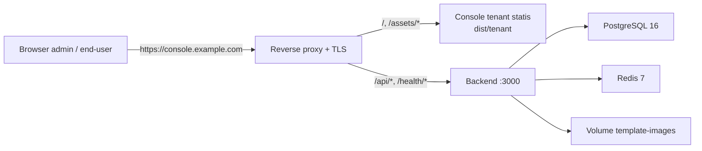

# Panduan deployment single tenant

Status: panduan operasional (bukan desain fitur). Basis: `docker-compose.prod.yml`,
`.env.prod.example`, `docs/design/platform-console-host-split.md`, dan
`docs/operations/production-readiness.md`.

Panduan ini untuk menjalankan NotifHub bagi **satu organisasi**: satu tenant (`default`), satu
console tenant, tanpa console platform dan tanpa billing. Skema database tetap multi-tenant agar
upgrade ke multi-tenant nanti tidak memerlukan migrasi besar.

**Isi dokumen**

- [1. Ruang lingkup](#1-ruang-lingkup)
- [2. Topologi](#2-topologi)
- [3. Prasyarat](#3-prasyarat)
- [4. Artefak yang dibangun](#4-artefak-yang-dibangun)
- [5. Konfigurasi environment](#5-konfigurasi-environment)
- [6. Menjalankan backend](#6-menjalankan-backend)
- [7. Menyajikan console tenant](#7-menyajikan-console-tenant)
- [8. Reverse proxy dan TLS](#8-reverse-proxy-dan-tls)
- [9. Integrasi konsumen](#9-integrasi-konsumen)
- [10. Verifikasi go-live](#10-verifikasi-go-live)
- [11. Operasional](#11-operasional)
- [12. Batasan](#12-batasan)
- [13. Checklist go-live](#13-checklist-go-live)

---

## 1. Ruang lingkup

Single tenant berarti:

- semua data berada di tenant `default`; tidak ada provisioning tenant lain;
- hanya console tenant yang di-deploy; **tidak** ada service `platform-console`;
- tidak ada `PLATFORM_ADMIN_EMAIL`/`PLATFORM_ADMIN_PASSWORD_HASH`;
- tidak ada billing/kuota per hit (lihat `docs/architecture/project-brief.md` §6).

Yang tetap berjalan: ingest, worker in-app/email/WhatsApp, SSE, Admin API, console tenant,
webhook, preference center, template system, dan observability. Lane platform tetap ada di kode,
tetapi tanpa akun platform tidak dapat dipakai; panduan ini juga memblokirnya di reverse proxy.

## 2. Topologi



- Console adalah **file statis** yang disajikan reverse proxy; tidak ada container console.
- Backend, Postgres, dan Redis berjalan lewat Compose; hanya reverse proxy yang menghadap internet.
- Satu origin untuk console dan API (`/api/*` diproxy) sehingga tidak ada CORS lintas origin.
  Ini menyederhanakan cookie/SSE dan CSP.

## 3. Prasyarat

- Docker Engine + Docker Compose v2 di server Linux.
- Domain, DNS, dan sertifikat TLS (Caddy dapat menerbitkan sendiri; nginx memakai certbot).
- Secret manager atau file env dengan permission `600` (jangan commit `.env.prod`).
- Penyimpanan backup di luar server (S3/NFS/objektif lain).
- Node 24 + npm hanya untuk **membangun** console statis (bisa di CI, tidak perlu di server).
- Port yang dibuka ke publik: **80/443 saja**. Port `3000` (backend), `5432`, `6379` tidak boleh
  terbuka.

## 4. Artefak yang dibangun

| Artefak | Perintah | Catatan |
|---|---|---|
| Backend runner | `docker build --target runner -t notifhub-api:<tag> .` | Node 24, non-root, hanya dependency produksi |
| Migrator | `docker build --target migrator -t notifhub-migrator:<tag> .` | One-shot `prisma migrate deploy` |
| Console tenant statis | `npm run console:build` → `console/dist/tenant` | Build dengan `VITE_NOTIFHUB_API_URL` produksi |

Image `runner-tenant` **tidak dipakai** di panduan ini: image itu mewajibkan
`PLATFORM_CONSOLE_URL` dan selalu me-redirect `/platform/*` ke host platform (lihat
`docs/design/platform-console-host-split.md` §18.2). Untuk single tenant, console statis lebih
sederhana dan tidak membawa route platform. Bila ingin semua serba container, tambahkan target
image standalone terpisah (belum ada) atau gunakan konfigurasi nginx sendiri.

## 5. Konfigurasi environment

Salin `.env.prod.example` ke `.env.prod`, lalu isi nilai berikut. Contoh memakai
`console.example.com`; ganti dengan domain final.

| Variabel | Wajib | Contoh / catatan |
|---|---|---|
| `NOTIFHUB_MODE` | ya | `production` |
| `NODE_ENV` | ya | `production` |
| `PORT` | ya | `3000` |
| `DATABASE_URL` | ya | Diisi Compose dari `POSTGRES_*`; isi eksplisit bila memakai DB terkelola |
| `REDIS_URL` | ya | Diisi Compose (`redis://redis:6379`); isi eksplisit bila Redis terkelola |
| `DEFAULT_TENANT_ID` | ya | `default` |
| `SERVICE_API_KEY` | ya | Minimal 16 karakter; dipakai bootstrap API key tenant `default` |
| `ADMIN_EMAIL` | ya | Email admin tenant pertama |
| `ADMIN_PASSWORD_HASH` | ya | Hasil `npm run admin:hash-password "..."` (bcrypt, kutip tunggal) |
| `ADMIN_JWT_SECRET` | ya | Minimal 32 karakter |
| `ADMIN_JWT_EXPIRES_IN` | tidak | Default `1h` |
| `SUBSCRIBER_JWT_SECRET` | ya | Minimal 32 karakter |
| `WEBHOOK_SIGNING_SECRET` | ya | Minimal 32 karakter |
| `CORS_ORIGINS` | ya | `https://console.example.com` (origin console) |
| `TEMPLATE_IMAGE_BASE_URL` | ya | `https://console.example.com` — tanpa ini URL gambar memakai host/protocol request yang bisa salah di belakang proxy |
| `SMTP_HOST`, `SMTP_PORT`, `SMTP_FROM` | ya | Wajib di luar development; kredensial SMTP sesuai provider |
| `SWAGGER_BASIC_AUTH_USER`, `SWAGGER_BASIC_AUTH_PASS` | ya | Wajib di luar development |
| `TEMPLATE_IMAGE_DIR` | tidak | Default Compose `/app/var/template-images`; harus persisten |
| `RETENTION_DAYS` | tidak | Default `90`; notifikasi lama di-soft-delete |
| `INGEST_RATE_LIMIT_PER_KEY` | tidak | Default `100` per menit; lihat batasan §12 |
| `PLATFORM_ADMIN_EMAIL`, `PLATFORM_ADMIN_PASSWORD_HASH` | **kosong** | Jangan diisi untuk single tenant |
| `PLATFORM_CONSOLE_URL`, `VITE_PLATFORM_CONSOLE_URL` | tidak dipakai | Hanya untuk image/console split; biarkan kosong |

Catatan keamanan:

- File `.env.prod` berisi secret; `chmod 600 .env.prod`, jangan masuk git.
- `SUBSCRIBER_JWT_SECRET` dan `WEBHOOK_SIGNING_SECRET` berbeda dari secret admin.
- Jika `ADMIN_PASSWORD_HASH` diubah, bootstrap memperbarui akun dan mencabut sesi lama. Sebaliknya,
  password yang diubah dari console tidak ditimpa restart selama hash env tidak berubah
  (`bootstrapPasswordHash` melacak nilai env terakhir).

## 6. Menjalankan backend

```bash
cp .env.prod.example .env.prod
# edit .env.prod: isi secret, domain, SMTP, dan kosongkan PLATFORM_*

docker compose --env-file .env.prod -f docker-compose.prod.yml build backend migrate
docker compose --env-file .env.prod -f docker-compose.prod.yml up -d backend
docker compose --env-file .env.prod -f docker-compose.prod.yml ps -a
```

`up -d backend` hanya menyalakan dependency-nya: `postgres`, `redis`, `migrate`, lalu `backend`.
Service `console` dan `platform-console` **tidak** ikut berjalan.

Yang harus terlihat:

- `migrate` berstatus `Exited (0)`;
- `postgres`/`redis`/`backend` `healthy`;
- log backend memuat `application.started` dan peringatan
  `platform.admin.bootstrap.missing` (normal untuk single tenant);
- `GET http://127.0.0.1:3000/health/ready` → `200`.

Batasi port `3000` agar tidak terbuka ke publik. Pilihan termudah adalah firewall (hanya 80/443).
Alternatif override Compose (butuh Compose ≥ 2.24 untuk `!override`):

```yaml
# docker-compose.single-tenant.yml
services:
  backend:
    ports: !override
      - "127.0.0.1:3000:3000"
```

Jalankan dengan `-f docker-compose.prod.yml -f docker-compose.single-tenant.yml`.

## 7. Menyajikan console tenant

Build console dengan API origin produksi. **Jangan** set `VITE_PLATFORM_CONSOLE_URL`; route
`/platform/*` di SPA akan menjadi halaman 404, dan reverse proxy juga memblokir path itu.

```bash
npm ci
npm run sdk:build
npm --prefix console ci
VITE_NOTIFHUB_API_URL="https://console.example.com" npm --prefix console run build

sudo mkdir -p /srv/notifhub/console
sudo rsync -a --delete console/dist/tenant/ /srv/notifhub/console/
```

Di PowerShell:

```powershell
$env:VITE_NOTIFHUB_API_URL = "https://console.example.com"
npm --prefix console run build
```

Artefak `console/dist/tenant` berisi `index.html` dan `assets/*`; tidak ada `platform.html`.
Build ulang setiap kali kode console berubah (bisa dijadikan artefak CI).

## 8. Reverse proxy dan TLS

Contoh Caddy (TLS otomatis, SPA fallback, API diproxy ke localhost):

```caddyfile
console.example.com {
    encode gzip

    # Defense in depth: single tenant tidak memakai lane platform.
    handle /api/v1/platform/* {
        respond 404
    }
    handle /platform/* {
        respond 404
    }
    handle /metrics {
        respond 404
    }

    # API + health ke backend; SSE tetap streaming.
    handle /api/* {
        reverse_proxy 127.0.0.1:3000
    }
    handle /health/* {
        reverse_proxy 127.0.0.1:3000
    }

    # Console statis dengan SPA fallback.
    handle {
        root * /srv/notifhub/console
        try_files {path} /index.html
        file_server
    }

    header {
        X-Content-Type-Options nosniff
        X-Frame-Options DENY
        Referrer-Policy no-referrer
        Content-Security-Policy "default-src 'self'; base-uri 'self'; frame-ancestors 'none'; object-src 'none'; script-src 'self'; style-src 'self' 'unsafe-inline'; img-src 'self' data: https:; font-src 'self' data:; connect-src 'self' https:; form-action 'self'"
    }
}
```

Padanan nginx (ringkas):

```nginx
server {
    listen 443 ssl http2;
    server_name console.example.com;
    root /srv/notifhub/console;

    add_header X-Content-Type-Options "nosniff" always;
    add_header X-Frame-Options "DENY" always;
    add_header Referrer-Policy "no-referrer" always;
    add_header Content-Security-Policy "default-src 'self'; base-uri 'self'; frame-ancestors 'none'; object-src 'none'; script-src 'self'; style-src 'self' 'unsafe-inline'; img-src 'self' data: https:; font-src 'self' data:; connect-src 'self' https:; form-action 'self'" always;

    location ^~ /api/v1/platform/ { return 404; }
    location ^~ /platform/        { return 404; }
    location ^~ /metrics          { return 404; }

    location /api/ {
        proxy_pass http://127.0.0.1:3000;
        proxy_http_version 1.1;
        proxy_set_header Host $host;
        proxy_set_header X-Forwarded-For $proxy_add_x_forwarded_for;
        proxy_set_header X-Forwarded-Proto $scheme;
        proxy_buffering off;          # SSE: /api/v1/in-app/stream
        proxy_read_timeout 3600s;
    }
    location /health/ { proxy_pass http://127.0.0.1:3000; }

    location / {
        try_files $uri /index.html;
    }
}
```

Catatan:

- `/api/docs` (Swagger) dilindungi basic auth; blokir di proxy bila tidak dipakai.
- `/metrics` jangan pernah publik; scrape dari localhost/jaringan internal.
- Jangan mengaktifkan buffering pada SSE (`/api/v1/in-app/stream`), atau event akan tertahan.
- Backend belum memakai `trust proxy`; lihat batasan rate limit di §12.

## 9. Integrasi konsumen

- Base URL API: `https://console.example.com/api/v1`.
- API key: buat lewat console tenant (menu API keys) atau `SERVICE_API_KEY` bootstrap.
- Tenant: `default`; `tenant_id` di body ingest (bila diisi) harus `default`.
- Kirim notifikasi: `POST /api/v1/notify` dengan header `X-API-Key`; buat dan publish template
  terlebih dahulu lewat console.
- End-user: token subscriber ditandatangani dengan secret API key tenant; lihat
  `docs/usage/end-user.md` dan `docs/design/preference-center.md`.
- SDK: `@notifhub/js`, `@notifhub/react`, dan Go SDK memakai OpenAPI publik
  (`openapi/notifhub.json`).

## 10. Verifikasi go-live

| Pemeriksaan | Perintah / aksi | Ekspektasi |
|---|---|---|
| Migrasi | `docker compose ... ps -a` | `migrate` `Exited (0)` |
| Health | `curl -fsS https://console.example.com/health/ready` | `200`, database + redis `up` |
| Console | `curl -I https://console.example.com/` | `200`, title `NotifHub Console` |
| Login | buka `/login`, masuk dengan `ADMIN_EMAIL` | dashboard tampil |
| API key | console → API keys | key baru tampil sekali |
| Ingest | `POST /api/v1/notify` dengan template aktif | `202` + notification id |
| Worker | detail notifikasi di console | status `sent`/`delivered` |
| SSE | buka sample end-user dengan token subscriber | event masuk tanpa buffering |
| Platform tertutup | `curl -I https://console.example.com/api/v1/platform/auth/login` | `404` (diblokir proxy) |
| Metrics tertutup | `curl -I https://console.example.com/metrics` | `404` |
| TLS | `curl -I http://console.example.com` | redirect ke `https` |

Catatan verifikasi (2026-11-20): topologi console statis + Caddy diuji terhadap smoke stack pada
port uji `18090` — `/` `200` (title `NotifHub Console`), `/login` `200`, `/platform/login` `404`,
`/api/v1/platform/*` `404`, `/metrics` `404`, `/health/ready` `200`, dan
`POST /api/v1/admin/auth/login` lewat proxy `200`. `docker compose --dry-run up -d backend`
menunjukkan hanya `postgres`, `redis`, `migrate`, dan `backend` yang disentuh; `console` dan
`platform-console` tidak ikut.

## 11. Operasional

### Backup

```bash
# database (sesuaikan -U/-d bila POSTGRES_USER/POSTGRES_DB diubah)
docker compose --env-file .env.prod -f docker-compose.prod.yml exec -T postgres \
  pg_dump -U notifhub -d notifhub -Fc > /backup/notifhub-$(date +%F).dump

# gambar template (volume)
docker run --rm \
  -v notifhub-prod_notifhub_prod_uploads:/data:ro \
  -v /backup:/backup \
  alpine tar czf /backup/uploads-$(date +%F).tgz -C /data .
```

- Uji restore secara berkala ke database kosong; backup yang belum pernah direstore belum terbukti.
- Redis tidak di-backup: antrean BullMQ dan buffer SSE bersifat sementara. Setelah restore, job yang
  belum diproses bisa hilang; notifikasi yang sudah `sent` tetap ada di Postgres.
- Simpan backup di luar server dan enkripsi bila berisi data pribadi.

### Upgrade

```bash
git pull
docker compose --env-file .env.prod -f docker-compose.prod.yml build backend migrate
docker compose --env-file .env.prod -f docker-compose.prod.yml up -d migrate
docker compose --env-file .env.prod -f docker-compose.prod.yml up -d backend

# console statis
npm ci && npm run sdk:build && npm --prefix console ci
VITE_NOTIFHUB_API_URL="https://console.example.com" npm --prefix console run build
sudo rsync -a --delete console/dist/tenant/ /srv/notifhub/console/
```

Urutan aman: backup → build → migrasi → backend → console. Migrasi bersifat forward-only; uji di
staging sebelum produksi.

### Monitoring dan log

- Health: `/health/live` dan `/health/ready` (readiness mengecek Postgres + Redis).
- Metrics internal: `/metrics` (queue depth, ingest, delivery latency, provider errors, SSE aktif).
- Log: JSON pino dari container backend; kirim ke log aggregator.
- Alert minimum: readiness gagal, queue depth naik terus, provider error rate, disk volume,
  sertifikat TLS mendekati kedaluwarsa.

### Retensi dan secret

- `RETENTION_DAYS` (default 90) melakukan soft-delete notifikasi; data tetap ada sampai dibersihkan
  manual. Template test-send/audit punya retensi terpisah.
- Rotasi `ADMIN_JWT_SECRET` membatalkan semua sesi admin (login ulang).
- Rotasi `SUBSCRIBER_JWT_SECRET`/secret API key memengaruhi token end-user; koordinasikan dengan
  integrator.
- Jangan pernah menaruh secret di image, log, atau console browser.

## 12. Batasan

1. **Satu akun admin dari environment.** Lane tenant belum punya endpoint manajemen akun admin;
   akun tambahan hanya bisa dibuat lewat lane platform (yang tidak diaktifkan di sini). Untuk
   single tenant, satu akun admin biasanya cukup.
2. **Tanpa billing/kuota per hit.** Tidak ada plan, counter, invoice, atau enforcement kuota.
3. **Image `runner-tenant` tidak dipakai** karena mewajibkan `PLATFORM_CONSOLE_URL` dan melakukan
   redirect platform. Panduan ini memakai console statis.
4. **Rate limit di belakang proxy.** Backend belum memakai `trust proxy`, sehingga `req.ip` bisa
   menjadi IP proxy dan limit per API key praktis menjadi global. Untuk single tenant, naikkan
   `INGEST_RATE_LIMIT_PER_KEY` sesuai kebutuhan atau batasi akses di proxy; jangan buka port 3000.
5. **`TEMPLATE_IMAGE_BASE_URL` wajib diisi eksplisit** karena protocol/host request di belakang
   proxy tidak otomatis benar tanpa `trust proxy`.
6. **Image single-arch (amd64)** dan belum dipush ke registry; bangun di server atau registry
   internal.
7. **WhatsApp hanya teks**; belum memakai approved-template Meta. Email bergantung SMTP provider.
   Alternatif WAHA self-hosted tersedia lewat `WHATSAPP_PROVIDER=waha` (tidak resmi, risiko banned);
   lihat `docs/design/whatsapp-waha-provider.md`.
8. **Tanpa browser automation permanen**; verifikasi UI dilakukan manual/protokol.

## 13. Checklist go-live

- [ ] Domain dan DNS mengarah ke server; TLS aktif dan HTTP redirect ke HTTPS.
- [ ] `.env.prod` berisi secret kuat, permission `600`, dan `PLATFORM_ADMIN_*` kosong.
- [ ] `migrate` exit `0`; backend `healthy`; `/health/ready` `200`.
- [ ] Port 3000/5432/6379 tidak terbuka ke publik.
- [ ] Console statis tersaji di `/`, login admin berhasil.
- [ ] `/api/v1/platform/*`, `/platform/*`, dan `/metrics` mengembalikan `404` dari publik.
- [ ] `CORS_ORIGINS` dan `TEMPLATE_IMAGE_BASE_URL` memakai origin HTTPS final.
- [ ] API key dibuat; `POST /api/v1/notify` `202`; worker mengirim; status terlihat di console.
- [ ] SSE berjalan tanpa buffering.
- [ ] Backup database + volume uploads terjadwal dan **restore sudah diuji**.
- [ ] Monitoring/alert untuk readiness, queue depth, provider error, dan disk.
- [ ] Kebijakan retensi dan rotasi secret disepakati.
